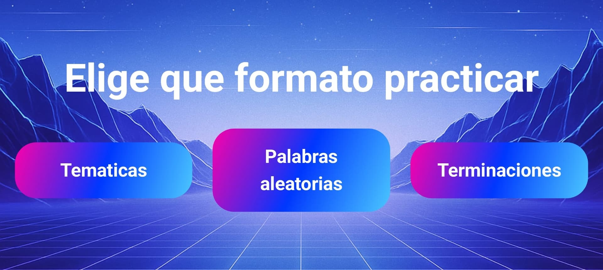
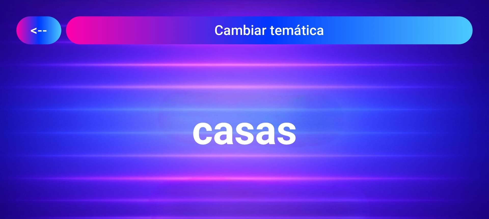
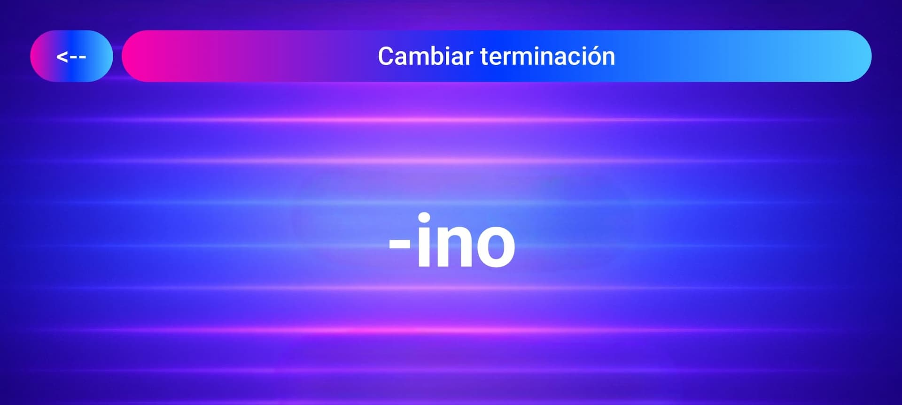
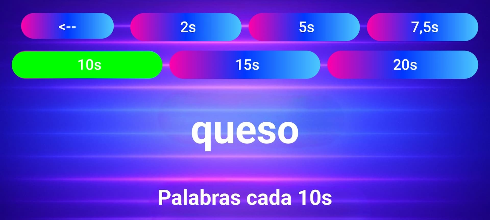

# Freestyle Practice App 🎤🔥

## 📱 About the App

**Freestyle Practice App** is a mobile application designed for all freestyle rap lovers who want to practice and improve their skills anywhere, anytime. 

With this app, you can choose different practice modes:
- **Rhyme endings**
- **Themes**
- **Random words**

Challenge yourself and boost your creativity, flow, and improvisation skills!

  
  
  
  

---

## 📑 Index

- [📱 About the App](#-about-the-app)
- [📥 Downloads](#-downloads)
- [🚀 Features](#-features)
- [🐛 Reporting Bugs & Feedback](#-reporting-bugs--feedback)

---

## 📥 Downloads

You can download the app here:

- [Download Freestylea 1.0.0](https://github.com/mesegr/Freestylea_APP/releases/tag/V1.0.0)

---

## 🚀 Features

✅ Practice with random rhyme endings  
✅ Choose specific themes to focus on  
✅ Get random words to freestyle about  
✅ Simple, clean, and intuitive interface  
✅ Ideal for beginners and experienced freestylers 

---

## 🐛 **Reporting Bugs & Feedback**  
Found a bug? Have suggestions?  
- Open an **Issue** on this repo.  

Please include:  
- **Description**: What happened?  
- **Steps to reproduce**: How can we trigger it?  
- **Screenshots/Videos** (if possible).  
